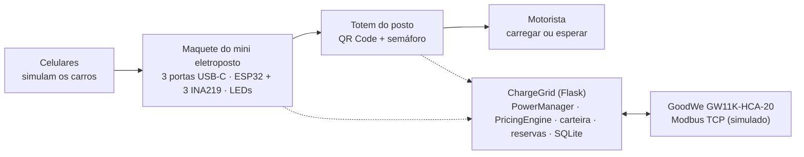
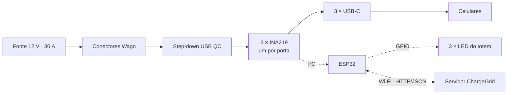
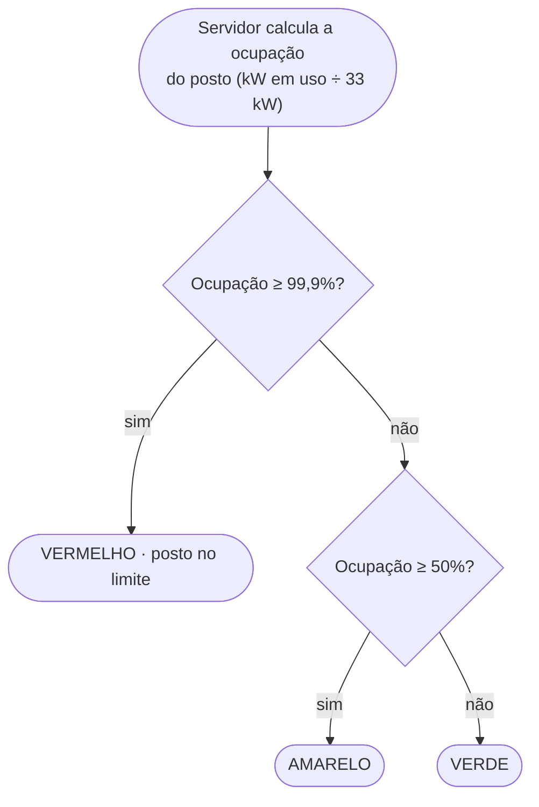
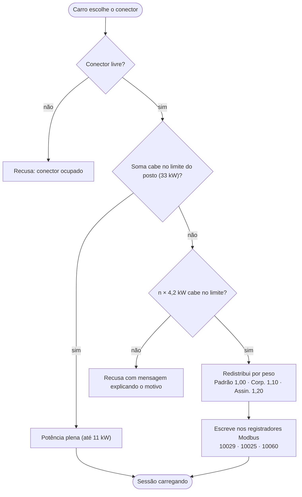
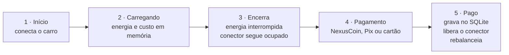
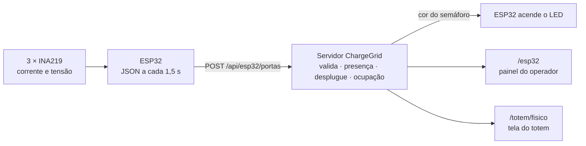
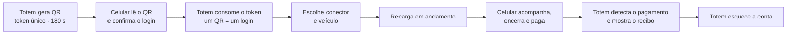

# ⚡ ChargeGrid Intelligence — NexusCharge

> **Sprint 4 — Solução Final Integrada e Inovadora**
> EV Challenge 2026 · FIAP + GoodWe · Time 6 · 1CCPZ (Ciência da Computação — Noturno)

| | |
|---|---|
| **Documento em PDF** | [`docs/ChargeGrid_Sprint4_Documentacao.pdf`](docs/ChargeGrid_Sprint4_Documentacao.pdf) |
| **Simulação Wokwi (Sprint 3)** | https://wokwi.com/projects/475464686061787137 |

---

## 1. Equipe

| Nome | RM |
|---|---|
| Alan Junio Araujo de Souza | 574112 |
| Arthur Vettorazzo de Souza | 569445 |
| Brayan Barbosa Dos Santos | 573682 |
| Giovanne Gomes Petenuci | 574091 |
| Gustavo Zibini Belizario | 561376 |
| Luiz Otávio Brito Freixo | 569977 |

---

## 2. Resumo

O **ChargeGrid Intelligence — NexusCharge** é um sistema de gestão de eletropostos comerciais que decide, a cada carro que chega, **quanta potência cada conector recebe**, **quanto custa a recarga** e **o que o motorista deve fazer**: carregar agora ou esperar.

O problema de partida é aritmético. Um posto com cinco carregadores GoodWe GW11K-HCA-20 soma 5 × 11 kW = **55 kW**, mas a entrada de energia do estabelecimento suporta **33 kW**. Sem gestão, o dono precisa pagar uma obra de ampliação; com gestão, a mesma instalação atende todos os carros.

**O que a Sprint 4 entrega.** Nas Sprints 1 a 3 construímos a orquestração de potência, a tarifação dinâmica, a comunicação Modbus TCP, a carteira digital (NexusCoin), as reservas e o painel do operador, tudo em software. Na Sprint 4 **a solução saiu do papel e foi integrada ao hardware**:

- uma **maquete de mini eletroposto** com **ESP32**, **3 sensores INA219** (um por porta) e **3 portas USB-C**, em que **celulares simulam carros**;
- o ESP32 envia ao site, por **Wi-Fi (HTTP/JSON)**, a corrente e a tensão de cada porta; o site decide a presença do carro, encerra a recarga quando o cabo é retirado e **devolve a cor do semáforo** que o ESP32 acende nos LEDs;
- um **totem no posto** que reúne duas funções: um **QR Code**, por onde o motorista acompanha e paga a recarga pelo celular (com ou sem conta), e o **semáforo** com a situação do posto;
- o **site ChargeGrid**, que ganhou o **Modo Totem** com pareamento por QR Code, veículos por conta, recarga sem conta pré-paga, reforços de segurança e a API de orçamento de potência de origem solar (seção 4.7).

Isso foi montado para a apresentação na **FIAP NEXT** e mostra, de forma física, a decisão do motorista: o carro chega, o semáforo sinaliza o estado do posto e ele escolhe entre carregar ou esperar.



*Figura 1 — Visão geral da solução na Sprint 4: celulares na maquete, ESP32 trocando dados com o site por Wi-Fi e o totem com QR Code e semáforo.*

---

## 3. Alinhamento ao desafio GoodWe

Cada ponto do desafio e a parte da solução que o resolve:

| Ponto do desafio | Como a solução resolve | Onde está |
|---|---|---|
| **Atender mais carros do que a instalação suporta** | `PowerManager` reparte o limite do posto (33 kW) entre todas as sessões, com peso por categoria de usuário. Do 4º carro em diante todos recebem menos potência, **nenhum é desligado**. | `power_manager.py` |
| **Proteger o hardware** | Piso de 4,2 kW por conector (mínima trifásica do HCA G2). Se `n × 4,2 kW` não cabe no limite, a conexão é recusada com explicação, em vez de derrubar o posto. | `power_manager.py` |
| **Tecnologia compatível GoodWe** | Hardware de referência **GW11K-HCA-20** (AC, 11 kW). Comunicação por **Modbus TCP**, porta 502, com os registradores documentados do HCA G2 (10015, 10016, 10017, 10025, 10026, 10029, 10060). | `modbus_simulator.py` |
| **Deslocar consumo do horário de pico** | Tarifa dinâmica em três eixos: pico (+50%), alta demanda (+30%) e categoria do usuário (−15% / −10%). A tarifa é fixada na conexão. | `pricing_engine.py` |
| **Energia renovável (exemplo do enunciado)** | O servidor aceita um **orçamento de potência vindo de geração solar** (`POST /api/energia`, com geração e consumo ou kW direto), reduz e devolve potência aos carros nos dois sentidos e é coberto por testes. | `app.py`, `power_manager.py` |
| **Informar o motorista** | **Mapa em tempo real** no site, com cada posto em uma cor de status (verde disponível, amarelo em redistribuição, vermelho lotado), e **semáforo físico** no totem, que segue a ocupação real do posto. | `templates/mapa.html`, `esp32.py`, firmware |
| **Integrar o físico ao digital** | ESP32 + INA219 medem as portas e informam o site; retirar o cabo encerra a recarga; o site devolve a cor do semáforo. | `esp32.py`, `firmware/`, `/api/esp32/portas` |
| **Atender o motorista no posto** | **Modo Totem**: tela de autoatendimento de um conector, login por QR Code lido no celular, acompanhamento e pagamento pelo celular. | `totem.py`, `templates/totem_*.html` |
| **Monetizar e fidelizar** | Carteira NexusCoin com 10% de cashback, reserva com sinal e recarga sem cadastro **pré-paga** (sinal de R$ 50,00; a sobra é devolvida). | `wallet.py`, `reservations.py`, `billing.py`, `avulso.py` |
| **Operar o posto** | Painel do operador com potência por posto, sessões ativas, log de quadros Modbus, estado das portas físicas (`/esp32`), receita e exportação em CSV. | `/admin`, `/dashboard`, `/modbus-log`, `/esp32` |

---

## 4. Arquitetura final e integração

### 4.1 Visão geral

A solução tem quatro camadas que conversam entre si:

1. **Experiência do motorista:** celulares (carros simulados), totem do posto (QR Code + semáforo), site com mapa, reserva, pagamento e carteira.
2. **Maquete do mini eletroposto:** ESP32, 3 sensores INA219, 3 portas USB-C e 3 LEDs, alimentados por fonte de 12 V / 30 A (seção 4.2).
3. **Sistema ChargeGrid (Python/Flask):** regras de potência, tarifa, cobrança, histórico e a ponte com o ESP32.
4. **Equipamento de referência:** GoodWe GW11K-HCA-20 via Modbus TCP (simulado).

### 4.2 Hardware da maquete

A maquete reproduz, em escala reduzida, o posto da Paulista (P1) com 3 carregadores: cada porta USB-C entrega energia real a um celular, que faz o papel do carro. As portas 1, 2 e 3 correspondem aos conectores **P1-C1, P1-C2 e P1-C3** do site.

| Componente | Função na maquete |
|---|---|
| **ESP32** | Lê as 3 portas a cada 1,5 s, envia o resultado ao servidor por Wi-Fi (HTTP/JSON) e acende o LED da cor que o servidor devolve. Sem resposta, usa uma regra local pelos carros detectados. |
| **3 × INA219** | Um sensor por porta (cada um com seu par de pinos I²C): mede corrente e tensão do que o celular consome. |
| **3 × LED** | Semáforo do totem (vermelho, amarelo e verde). |
| **Módulo step-down USB Quick Charge** | Reduz os 12 V da fonte para a tensão de carga do celular, com negociação Quick Charge. |
| **Conector fêmea USB-C** | Ponto de recarga onde o celular ("carro") é conectado. |
| **Fonte 12 V / 30 A** | Alimentação do conjunto (até 360 W). |
| **Conectores Wago de 5 e 10 vias** | Distribuição de positivo e negativo entre os módulos, sem solda. |
| **Cabos jumper** | Ligações de sinal entre ESP32, sensores e LEDs. |



*Figura 2 — Alimentação, sensores e comunicação da maquete.*

### 4.3 Totem do posto: QR Code e semáforo

O totem do posto tem duas funções. O **QR Code** leva o motorista ao celular: quem tem conta entra pelo pareamento por QR (sem digitar senha na tela pública) e quem não tem conta informa só a placa e paga um sinal de R$ 50,00. Em ambos os casos o motorista acompanha, encerra e paga pelo navegador do celular, sem instalar aplicativo. O **semáforo** é a ideia inicial do projeto: mostra o estado do posto em uma cor, para o motorista decidir sem precisar entender o que acontece por trás. É a versão física do status que o mapa do site já mostra, na mesma escala de três cores.

A cor segue a **ocupação do posto**, isto é, a potência em uso dividida pelo limite de 33 kW:

| Cor | Ocupação do posto | Significado para o motorista |
|---|---|---|
| 🟢 **Verde** | abaixo de 50% | Há folga e potência plena. Pode carregar. |
| 🟡 **Amarelo** | de 50% até menos de 99,9% | O posto está enchendo. Ainda cabem carros, e a potência é dividida entre eles. |
| 🔴 **Vermelho** | 99,9% ou mais (posto no limite) | Posto cheio: um novo carro obriga a redistribuir a potência, e todos carregam mais devagar. |

Com carros de 11 kW em um posto de 33 kW, isso significa: até 1 carro, verde; 2 carros, amarelo; 3 ou mais, vermelho. A regra vale para qualquer sessão do posto, venha do totem físico, do app ou do operador.



*Figura 3 — Como a cor do semáforo é escolhida. Sem resposta do servidor, o ESP32 usa a regra local: 0–1 carro verde, 2 amarelo, 3 vermelho.*

### 4.4 Arquitetura de software

Arquitetura modular em camadas, sem dependências circulares e sem regra de negócio na camada web.

```
models.py               Entidades e enums (ChargingSession, SessionStatus, UserType)
   ↑
algoritmos.py           Busca e ordenação manuais + estatísticas (só stdlib)
   ↑
session_manager.py      Ciclo de vida das sessões e acúmulo de energia
   ↑
power_manager.py        Controle de demanda: limite, throttle, rebalanceamento, orçamento solar
   ↑
modbus_simulator.py     Quadros Modbus TCP (registradores HCA G2)

pricing_engine.py       Tarifação dinâmica em 3 eixos
esp32.py                Ponte com o hardware: validação, presença, desplugue, semáforo
db.py                   Persistência SQLite (stdlib) — carteira, reservas, histórico
auth.py · wallet.py · reservations.py · billing.py · avulso.py · veiculos.py · totem.py · qr.py
   ↑
app.py                  Camada web Flask — rotas, validação e orquestração
menu.py                 Camada de terminal — mesmo sistema, sem Flask
```



*Figura 4 — Decisão de potência, do carro que chega até a sessão carregando.*

**Decisão de potência.** Quando o carro que chega não cabe, o sistema redistribui. `_target_por_peso` reparte os 33 kW entre todas as sessões usando um peso por categoria (Padrão 1,00 · Corporativo 1,10 · Assinante 1,20). Se `n × 4,2 kW` já não cabe, a conexão é recusada com mensagem explicativa.

**Duas vidas da sessão.** Enquanto carrega, a sessão vive em memória; quando o motorista paga, é gravada no SQLite. Isso evita escrita em disco a cada ciclo e mantém o histórico após reiniciar.

**O pagamento libera o conector.** Com conta, encerrar a recarga (pelo app, pelo totem, pelo celular ou retirando o cabo) interrompe a energia e redivide a potência na hora, mas o conector fica **retido** até o pagamento ser confirmado. Na recarga sem conta, que é pré-paga, o conector é liberado ao fim da recarga.



*Figura 5 — Ciclo de vida da sessão: memória enquanto carrega, banco depois de paga.*

### 4.5 Integração com o equipamento GoodWe

O GW11K-HCA-20 fala **Modbus TCP** na porta 502. Em mentoria com a GoodWe confirmamos que a linha HCA G2 não suporta OCPP, por isso o sistema usa Modbus.

| Registrador | Função | Acesso |
|:-:|---|:-:|
| 10015 | Potência de recarga (÷10 = kW) | Leitura |
| 10016 | Energia da sessão (÷10 = kWh) | Leitura |
| 10017 | Status da estação | Leitura |
| 10025 | Gestão dinâmica de carga | Leitura/Escrita |
| 10026 | Corrente do disjuntor (A) | Leitura/Escrita |
| 10029 | Potência máxima de recarga | Leitura/Escrita |
| 10060 | Liga/desliga recarga | Leitura/Escrita |

O `modbus_simulator.py` monta o quadro ADU completo (cabeçalho MBAP + PDU), registra cada quadro num log consultável e o exibe em `/modbus-log`. Exemplo, habilitando o carregamento do conector P1-C1:

```
TX | FC06 Write | Reg 10060 | Data: ['0x0002']
HEX: 00 01 00 00 00 06 01 06 27 4C 00 02
```

> **Escopo da integração:** o protocolo e os registradores são os do HCA G2, mas **não tivemos acesso a um carregador GoodWe real**. Em todas as Sprints a comunicação com o carregador foi **simulada em software** (`modbus_simulator.py`), e na maquete a recarga é representada em escala por USB-C. Os quadros Modbus seguem o formato real, então a troca do simulador por um equipamento de verdade não exige mudar as regras de negócio.

### 4.6 Integração entre a maquete e o site

A maquete conversa com o site de verdade. A cada 1,5 s o ESP32 envia um `POST /api/esp32/portas` com a corrente e a tensão das 3 portas, autenticado por um token no cabeçalho `X-ESP32-Token`. O servidor valida a mensagem, decide a presença e responde com a cor do semáforo.



*Figura 6 — Comunicação entre o ESP32 e o servidor.*

| Regra | Como funciona |
|---|---|
| **Mapeamento** | Porta 1 → P1-C1, porta 2 → P1-C2, porta 3 → P1-C3 (posto Paulista). |
| **Presença** | Corrente medida de 20 mA ou mais. É decidida no servidor, então calibrar não exige regravar o firmware. |
| **Plugar o cabo** | Aponta a tela do totem físico para o conector. A sessão nasce quando o motorista se identifica: pelo QR Code (com conta) ou pela placa (sem conta). |
| **Retirar o cabo** | Encerra a recarga ativa depois de 3 leituras livres seguidas (≈ 4,5 s), para um mau contato não derrubar a recarga. Só vale para recargas em que a porta já foi vista plugada. Com conta, o conector fica retido até o pagamento; sem conta, a sobra do sinal é devolvida. |
| **Sensor mudo** | Se um INA219 não responde, a porta é reportada como "sem leitura", e não como livre. |
| **ESP32 offline** | Sem mensagem por mais de 10 s, o servidor dá o totem como offline. |
| **Potência medida** | O servidor converte 1 W medido em 1 kW na aplicação (celular no lugar do carro), com teto de 11 kW. A medição é gravada e visível em `/esp32`; por padrão a cobrança segue a potência simulada do conector, e `CHARGEGRID_COBRANCA_MEDIDA=1` passa a cobrar pela medida. |
| **Segurança** | Mensagens são validadas campo a campo (faixas de corrente e tensão, tipos, portas repetidas) e o token é comparado em tempo constante. Para a apresentação, o token deve ser definido em `CHARGEGRID_ESP32_TOKEN`. |

Há ainda um **simulador do ESP32** (`tools/simular_esp32.py`), que envia ao servidor o mesmo JSON do firmware com as portas escolhidas como plugadas, para testar sem o hardware.

### 4.7 Novidades do software nesta Sprint

| Novidade | O que faz |
|---|---|
| **Ponte com o ESP32** | `esp32.py` e as rotas `/api/esp32/portas`, `/api/esp32/estado`, `/esp32` e `/totem/fisico`: recebem o estado das portas, detectam o desplugue e devolvem a cor do semáforo. |
| **Modo App / Modo Totem** | Alterna entre a experiência de celular do motorista e a tela vertical de autoatendimento do totem. O totem controla um conector, não mostra mapa nem outros postos, e esquece quem usou ao terminar. |
| **Pareamento por QR Code** | O totem gera um QR dinâmico (validade de 180 s, uso único). O celular lê, confirma o login e o totem entra com a conta, sem senha digitada numa tela pública. |
| **Veículos por conta** | Vários carros por conta, cadastro de carro avulso e bloqueio de duas recargas ativas para a mesma placa. |
| **Recarga sem conta pré-paga** | Visitante informa a placa e paga um sinal de R$ 50,00. A recarga termina sozinha ao consumir o valor pago, nunca cobra acima dele, e encerrar antes (no totem, no celular ou retirando o cabo) devolve o restante. |
| **Pagamento com conta** | O conector só é liberado depois de pago; até lá o valor fica como pendente na Carteira (acima de R$ 100 ou 7 dias, novas recargas ficam bloqueadas). |
| **Acompanhamento omnichannel** | O celular acompanha a recarga em tempo real, encerra e paga; o totem detecta o pagamento feito no celular e avança sozinho para o recibo. |
| **Orçamento de potência solar** | `POST /api/energia` (token `X-Token`) recebe geração e consumo (ou kW direto) de um controlador solar e aplica um novo orçamento ao posto, reduzindo e devolvendo potência aos carros nos dois sentidos. |
| **Segurança e resiliência** | Cabeçalhos defensivos (OWASP), proteção contra open redirect, correção de clock skew na duração da sessão, páginas de erro 404/500 e buffer circular no histórico de alocações. |
| **Busca e ordenação no relatório** | `merge_sort` (O(n log n)) e busca sequencial aplicados às tabelas do relatório. |



*Figura 7 — Pareamento entre totem e celular.*

---

## 5. Justificativa de alinhamento à disciplina

O projeto trabalha duas frentes que se encontram no mesmo código: **engenharia de software** e **gestão de energia**.

| Conteúdo da disciplina | Onde aparece no projeto |
|---|---|
| **Modularização** | 20 módulos Python com responsabilidades separadas (potência, tarifa, carteira, reservas, billing, totem, veículos, hardware); o acesso ao banco passa pelos helpers de `db.py`. |
| **Estruturas de dados e algoritmos** | `busca_sequencial` em `get_session` e na busca do relatório, `merge_sort` na ordenação das tabelas do relatório e `insertion_sort` em `rebalance`, rodando em produção; busca binária e bubble sort no menu, com contagem de operações. |
| **Dicionários, tuplas, JSON** | Mapa de registradores Modbus, postos, conectores e mapeamento porta → conector em dicionários; `/api/status` e `/api/esp32/portas` trocam estado em JSON. |
| **Integração com sensores e IoT** | INA219 (I²C), ESP32 (Wi-Fi, HTTP/JSON), validação de mensagens, token e detecção de desplugue com histerese. |
| **Tratamento de erros** | Banco ausente ou corrompido abre com histórico vazio; mensagens inválidas do ESP32 são recusadas com texto explicativo; sensor mudo vira "sem leitura". |
| **Persistência e eficiência** | Sessões ativas em memória, só as pagas vão ao disco. |
| **Gestão de energia** | Redistribuição proporcional (*load shedding* proporcional), prioridade por classe, tarifa por horário de pico e orçamento dinâmico por geração solar. |
| **Testes automatizados** | Suíte de 414 testes `pytest` sobre tarifa, potência, reservas, billing, veículos, totem, ESP32, algoritmos e rotas, rodando contra banco temporário. |

---

## 6. Resultados

### 6.1 Resultados medidos no sistema

Os números abaixo saíram de executar o sistema, não de estimativa.

**Orquestração de potência num posto de 33 kW** (carros de 11 kW, um de cada vez):

| Carros conectados | Potência por carro | Carga total | Ocupação |
|:-:|:-:|:-:|:-:|
| 1 | 11,0 kW | 11,0 kW | 33,3% |
| 2 | 11,0 kW | 22,0 kW | 66,7% |
| 3 | 11,0 kW | 33,0 kW | 100,0% |
| 4 | 8,25 kW | 33,0 kW | 100,0% |
| 5 | 6,6 kW | 33,0 kW | 100,0% |

A carga total nunca passa de 33,0 kW e nenhum conector cai abaixo do piso de 4,2 kW. Com categorias diferentes num posto cheio, medimos 7,47 kW para o assinante, 6,84 kW para o corporativo e 6,22 kW para cada um dos três padrão, somando os mesmos 33 kW.

**Tarifação** (base R$ 1,20/kWh):

| Hora | Categoria | Posto vazio | Posto lotado |
|---|---|---:|---:|
| 14h | Padrão | R$ 1,20 | R$ 1,56 |
| 14h | Assinante | R$ 1,02 | R$ 1,326 |
| 19h (pico) | Padrão | R$ 1,80 | R$ 2,34 |
| 19h (pico) | Assinante | R$ 1,53 | R$ 1,989 |

**Histórico acumulado** (base sintética gerada pelas mesmas regras do produto, 27/07/2026 a 09/09/2026):

| Medida | Valor |
|---|---:|
| Sessões pagas | 180 |
| Receita faturada | R$ 4.205,76 |
| Energia entregue | 2.878,23 kWh |
| Duração média | 102,5 min |

**Comunicação Modbus:** o ciclo de cinco sessões gerou 31 quadros Modbus.

**Testes:** suíte de **414 testes automatizados** com `pytest`, cobrindo tarifa, redistribuição de potência, reservas, billing, veículos, totem com e sem conta, ponte com o ESP32, algoritmos, rotas e segurança, rodando contra um banco temporário.

### 6.2 Resultados da maquete (protótipo de bancada)

Parâmetros e comportamentos do protótipo físico integrado ao site:

| Item | Valor |
|---|---|
| Portas monitoradas | 3 (P1-C1, P1-C2, P1-C3) |
| Ciclo de leitura e envio | 1,5 s |
| Ruído do sensor sem carga | ±0,4 mA |
| Limiar de presença | 20 mA |
| Confirmação de desplugue | 3 leituras livres seguidas (≈ 4,5 s) |
| ESP32 considerado offline | sem mensagem por mais de 10 s |
| Semáforo (carros de 11 kW em 33 kW) | 1 carro verde · 2 amarelo · 3 vermelho |
| Escala da demonstração | 1 W medido na porta = 1 kW na aplicação (teto de 11 kW) |

O comportamento esperado do ciclo completo foi o que montamos para a demonstração: o celular é plugado, o motorista se identifica, o semáforo muda conforme os carros entram, e retirar o cabo encerra a recarga e leva o totem ao pagamento.

### 6.3 Resultados qualitativos

- O motorista passa a ter **a informação no ponto de decisão**: ele vê no totem se vale a pena carregar agora, sem abrir aplicativo.
- A tela do posto explica por que a potência não é 11 kW, então nenhum carro "some" nem é interrompido sem aviso.
- O operador enxerga potência, receita, frames Modbus, sessões e o estado das portas físicas num painel único.
- A maquete torna a solução **demonstrável de forma tátil**: o público pluga celulares e vê o semáforo e o site reagirem.

---

## 7. Diferenciais inovadores

| Diferencial | Como aparece |
|---|---|
| **Algoritmos inteligentes** | Redistribuição ponderada por categoria sob restrição de limite e piso físico; tarifa dinâmica em três eixos fixada na conexão; orçamento de potência dinâmico por geração solar; busca e ordenação implementadas à mão em uso real. |
| **Automação avançada** | Rebalanceamento automático ao liberar conector; reserva com sinal que expira sozinha; **encerramento automático da recarga ao retirar o cabo**; recarga pré-paga que para sozinha ao consumir o valor pago; escrita automática nos registradores Modbus. |
| **Interface amigável** | Semáforo de três cores que dispensa leitura; mapa em tempo real; login por QR Code sem senha no totem; acompanhamento e pagamento pelo celular, com ou sem conta; tema claro/escuro com contraste WCAG AA e foco de teclado. |
| **Visualização de dados** | Dashboard com barra de ocupação por posto, mapa com estado dos postos, painel das portas físicas (`/esp32`), relatório consolidado e exportação CSV. |
| **Solução física integrada** | Maquete de mini eletroposto com celulares como carros, sensores de corrente e semáforo que reage ao estado real do posto no site. |

---

## 8. Avaliação crítica: sustentabilidade e inovação

### Ganhos

- **Menos infraestrutura para a mesma frota.** Atender cinco carros de 11 kW exigiria 55 kW de entrada. Com orquestração, os mesmos cinco carregam dentro dos 33 kW já instalados, ou seja, **40% menos capacidade contratada** (22 de 55 kW). Isso significa menos obra, menos cobre e menos pico de demanda sobre a rede.
- **Deslocamento de consumo.** A tarifa de pico (+50%) e de alta demanda (+30%) empurra o consumo para fora do horário de maior estresse da rede (18h–23h), o mesmo princípio da tarifa branca.
- **Pronto para energia renovável.** O posto já aceita um orçamento de potência vindo de geração solar e redistribui nos dois sentidos: se a geração cai, os carros recebem menos; se sobe, voltam à potência cheia.
- **Vida útil do hardware.** O piso de 4,2 kW evita ciclos de liga/desliga no HCA G2; reduzir potência de forma contínua é mais suave que cortar.
- **Eficiência computacional.** Sessão ativa em memória e só a paga no disco evita escrita constante, o mesmo princípio de não gastar recurso onde não precisa.
- **Relevância social.** Decisão transparente para o motorista e acesso sem cadastro (sinal de R$ 50,00, com devolução da sobra) reduzem a barreira de uso.

### Limitações (o que ainda não foi feito)

- **Sem controlador solar físico.** A API de orçamento solar (`/api/energia`) está implementada e testada, mas a maquete não inclui um controlador solar real. O limite de 33 kW é um parâmetro fixo enquanto não houver essa medição. Por isso o projeto **não reduz emissões por conta própria**: o ganho ambiental é de infraestrutura e de gestão de pico, e não calculamos redução de CO₂ por falta de fonte confiável.
- **Detecção de presença por corrente.** O ruído do sensor é de ±0,4 mA, mas um celular com bateria cheia puxa cerca de 0,7 mA, indistinguível de "desplugado" com o limiar de 20 mA. Na demonstração usamos celular com bateria baixa ou carga fixa.
- **Cobrança por potência simulada.** A potência medida é gravada, mas por padrão a cobrança segue os 11 kW simulados, para a demonstração ser previsível.
- **Wi-Fi do ESP32.** A queda de Wi-Fi é uma limitação conhecida: as recargas seguem até alguém encerrar ou o ESP32 voltar.
- **Dados de uso simulados.** O histórico de 180 sessões foi gerado sinteticamente pelas regras do produto, então receita e energia mostram o funcionamento, não demanda real.
- **Sem carregador GoodWe real.** Não tivemos acesso ao equipamento. A comunicação Modbus foi validada contra o simulador e a maquete usa USB-C em escala.
- **Pagamento e autenticação são mockups acadêmicos.** Pix, cartão e contas de demonstração são simulados, e os pagamentos pendentes vivem na memória do servidor.
- **Token de desenvolvimento.** O ESP32 usa um token padrão de desenvolvimento enquanto `CHARGEGRID_ESP32_TOKEN` não é definido; em rede aberta, defini-lo é obrigatório.

### Próximos passos

1. Ligar um controlador solar físico (Raspberry Pi Pico W) à API `/api/energia`, que já existe.
2. Guardar os pagamentos pendentes no banco, em vez da memória do servidor.
3. Validar a comunicação Modbus em um GW11K-HCA-20 real.
4. Dividir o `app.py` em Blueprints do Flask.

---

## 9. Referências, ferramentas e tecnologias

| Categoria | Item |
|---|---|
| **Hardware de referência** | GoodWe GW11K-HCA-20 (AC, 11 kW, linha HCA G2) |
| **Hardware da maquete** | ESP32, 3 sensores INA219, 3 LEDs, módulo step-down USB Quick Charge, conectores USB-C, fonte 12 V / 30 A, conectores Wago e cabos jumper |
| **Firmware** | Arduino IDE (C++), bibliotecas Adafruit INA219 e BusIO, Wi-Fi 2,4 GHz, HTTP/JSON (firmware 0.3.0) |
| **Protocolos** | Modbus TCP (porta 502, Unit ID 0x01, simulado); HTTP/JSON entre ESP32 e servidor; I²C entre ESP32 e sensores |
| **Linguagem e backend** | Python 3.11+, Flask |
| **Persistência** | SQLite (`sqlite3` da biblioteca padrão, sem ORM) |
| **Frontend** | HTML5, CSS3, JavaScript puro |
| **Mapa** | Leaflet + OpenStreetMap |
| **Testes** | pytest |
| **Simulação de circuito** | Wokwi — https://wokwi.com/projects/475464686061787137 |
| **Mentoria** | Mentoria GoodWe (confirmação de que a linha HCA G2 não suporta OCPP) |

---

## 10. Como executar

**Pré-requisito:** Python 3.11+.

```bash
pip install flask pytest

python app.py      # http://localhost:5001
python menu.py     # menu de terminal (Estruturas de Dados)
pytest -q          # 414 testes
```

No Windows, dois cliques em `iniciar.bat` abre um menu com aplicativo web, gestão de sessões e testes.

**Contas de demonstração** (senha `1234`):

| Usuário | Categoria | Saldo | Para demonstrar |
|---|---|---:|---|
| `amanda` | Assinante | 100 NC | Recarga, pagamento e cashback |
| `allan` | Corporativo | 5 NC | Saldo insuficiente e recarga da carteira |
| `jose` | Padrão | 0 NC | Carteira zerada, Pix ou cartão |
| `luiz` | Assinante | 150 NC | Pareamento celular-totem por QR Code e recarga no totem |
| `mylon` | Operador | 10.000 NC | Painel, log Modbus, estado das portas, exportação |

O Modo Totem abre em `/totem` (ou pelo botão de alternância de modo no topo). O mapa usa tiles do OpenStreetMap e precisa de internet; sem conexão, a lista de postos continua funcionando.

**Totem físico (ESP32):**

1. Copie `firmware/totem_esp32/config.example.h` para `config.h` e preencha `WIFI_SSID`, `WIFI_SENHA`, `SERVIDOR_IP` (o IP da linha "Rede" que o servidor mostra ao iniciar) e `TOKEN_ESP32`.
2. Envie `totem_esp32.ino` ao ESP32 pela Arduino IDE (placa ESP32, Wi-Fi de 2,4 GHz).
3. Suba o servidor com `python app.py`. Para trocar o token de desenvolvimento, defina `CHARGEGRID_ESP32_TOKEN` com o mesmo valor do `config.h`.
4. Abra `/totem/fisico` (atalho "Totem físico (ESP32)" no rodapé do totem) e `/esp32` para acompanhar as portas.
5. Sem o hardware, use o simulador: `python tools/simular_esp32.py --plugadas 1 3`.

---

## 11. Estrutura do repositório

```
.
├── README.md
├── app.py · menu.py · power_manager.py · pricing_engine.py · esp32.py · ...   código do sistema
├── templates/ · static/                       site
├── firmware/totem_esp32/                      firmware do ESP32
├── tools/simular_esp32.py                     simulador do ESP32
├── test_chargegrid.py                         testes
└── docs/
    ├── ChargeGrid_Sprint4_Documentacao.pdf
    └── entregaveis_Sprint4.txt
```

---

## 12. Licença

Projeto acadêmico desenvolvido para o EV Challenge 2026 (FIAP + GoodWe).
